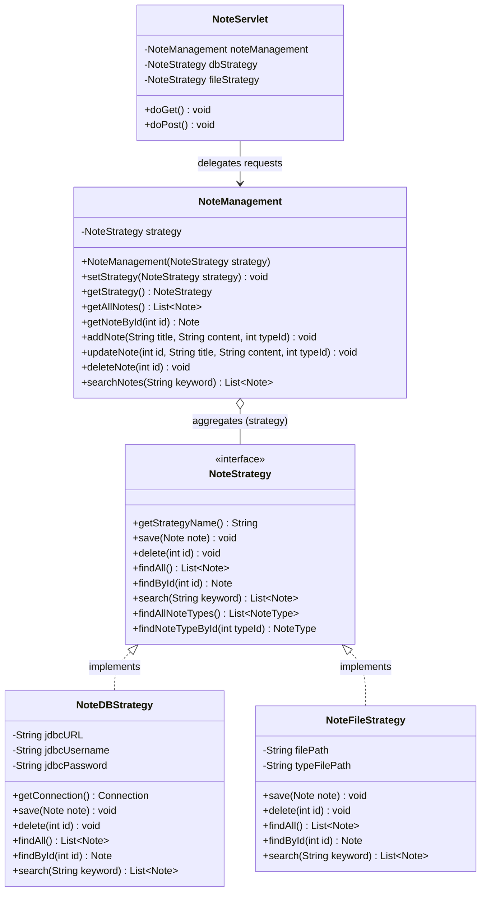
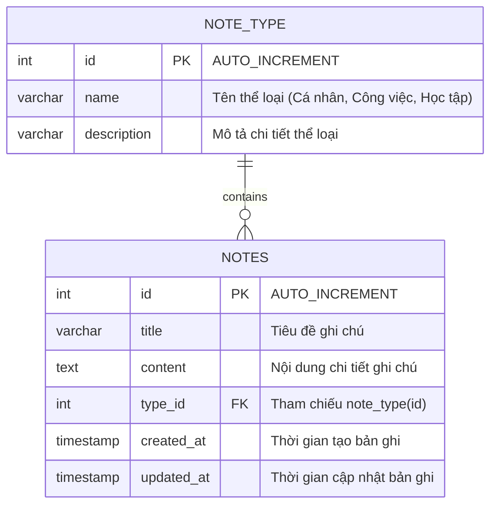

# Case Study: Ứng dụng Quản Lý Ghi Chú Cá Nhân iNotes (Strategy Pattern)

> Khóa học: Java Web Developer (JWBD) - CodeGym  
> Sinh viên thực hiện: Nguyễn Tuấn Đạt  
> Email: proyctk03@gmail.com  
> Repository: `https://github.com/proyctk03-eng/git-final-practice`  
> Công nghệ: Java Servlet API 6.0, JSP 3.1, JSTL 3.0, JDBC MySQL, Flat File, Strategy Pattern, Bootstrap 5.3.3  

---

## 1. Giới thiệu dự án & Mục tiêu nghiệp vụ

Ứng dụng **iNotes** là giải pháp quản lý ghi chú cá nhân thường nhật, giải quyết bài toán ghi nhớ khối lượng thông tin lớn trong công việc, học tập và cuộc sống.

Mục tiêu kỹ thuật cốt lõi của bài toán là áp dụng mẫu thiết kế **Strategy Pattern (Hành vi - Behavioral Pattern)** để:
1. Độc lập hóa hoàn toàn tầng nghiệp vụ và giao diện khỏi tầng lưu trữ cụ thể.
2. Hỗ trợ cơ chế **Runtime Pluggable Storage**: Hệ thống có khả năng chuyển đổi linh hoạt qua lại giữa hai cơ chế lưu trữ:
   - **Cơ sở dữ liệu quan hệ (MySQL Database)** thông qua JDBC.
   - **Tập tin văn bản phân tách (Flat File txt/csv)** theo định dạng `id|title|content|typeId`.
3. Cho phép người dùng chuyển đổi tầng lưu trữ tức thời chỉ bằng một cú nhấp chuột trên giao diện mà không phải khởi động lại máy chủ hoặc sửa đổi bất kỳ dòng mã logic giao diện nào.

---

## 2. Kiến trúc Mẫu thiết kế Strategy Pattern trong iNotes

Mẫu thiết kế Strategy Pattern trong iNotes bao gồm 3 thành phần chính:



### Chi tiết các thành phần:
- **Strategy Interface (`NoteStrategy`)**: Hợp đồng chung định nghĩa toàn bộ thao tác CRUD và tìm kiếm dữ liệu.
- **Concrete Strategy 1 (`NoteDBStrategy`)**: Triển khai kết nối MySQL qua giao diện `java.sql.PreparedStatement`, truy vấn các bảng `notes` và `note_type`.
- **Concrete Strategy 2 (`NoteFileStrategy`)**: Triển khai đọc và ghi dữ liệu ra tệp `notes.txt` theo định dạng `id|title|content|typeId`, tự động khởi tạo dữ liệu mẫu và đồng bộ hóa thread-safe.
- **Context (`NoteManagement`)**: Giữ tham chiếu đến một đối tượng `NoteStrategy` và cung cấp phương thức `setStrategy(NoteStrategy strategy)` cho phép thay đổi thuật toán lưu trữ lúc đang chạy (runtime).
- **Client / Controller (`NoteServlet`)**: Tiếp nhận các HTTP request, gọi các phương thức của `NoteManagement` và điều phối giao diện JSP tương ứng.

---

## 3. Thiết kế Cơ sở dữ liệu MySQL (`inotes_db`)

CSDL bao gồm 2 bảng có mối quan hệ 1 - N:



### Kịch bản SQL khởi tạo (`database/init.sql`)
```sql
CREATE DATABASE IF NOT EXISTS inotes_db CHARACTER SET utf8mb4 COLLATE utf8mb4_unicode_ci;
USE inotes_db;

CREATE TABLE IF NOT EXISTS note_type (
    id INT PRIMARY KEY AUTO_INCREMENT,
    name VARCHAR(100) NOT NULL,
    description VARCHAR(255)
);

CREATE TABLE IF NOT EXISTS notes (
    id INT PRIMARY KEY AUTO_INCREMENT,
    title VARCHAR(255) NOT NULL,
    content TEXT,
    type_id INT,
    created_at TIMESTAMP DEFAULT CURRENT_TIMESTAMP,
    updated_at TIMESTAMP DEFAULT CURRENT_TIMESTAMP ON UPDATE CURRENT_TIMESTAMP,
    CONSTRAINT fk_notes_note_type FOREIGN KEY (type_id) REFERENCES note_type(id) ON DELETE SET NULL
);
```

---

## 4. Thiết kế Định dạng Lưu Trữ Tập Tin (`NoteFileStrategy`)

Khi người dùng chuyển sang chế độ lưu trữ File, dữ liệu được ghi nhận vào tệp `notes.txt` với quy ước định dạng phân tách bằng ký tự sổ thẳng `|`:

```
id|title|content|typeId
```

Ví dụ dữ liệu tệp tin:
```text
1|Họp giao ban đầu tuần (File)|Báo cáo tiến độ module Strategy Pattern và tổng kết sprint trước|2
2|Ôn tập Design Pattern Servlet (File)|Nghiên cứu áp dụng Strategy Pattern, Singleton và Factory trong Java Web MVC|3
3|Lên lịch tập thể dục buổi sáng (File)|Chạy bộ 30 phút và tập cardio nhẹ nhàng lúc 6h00|1
```

- Ký tự xuống dòng trong nội dung ghi chú được escape tự động thành `\n` để đảm bảo mỗi bản ghi nằm trọn vẹn trên một dòng tệp tin.
- Hệ thống tự động cấp phát ID tăng dần và tự động khởi tạo thư mục và tệp nếu chưa tồn tại.

---

## 5. Cấu trúc thư mục mã nguồn

```
inotes-app/
├── pom.xml                                     # Cấu hình Maven War (Jakarta EE 10 / Tomcat 10.1+)
├── README.md                                   # Tài liệu kỹ thuật chi tiết
├── database/
│   └── init.sql                                # Kịch bản khởi tạo CSDL và dữ liệu mẫu
└── src/
    └── main/
        ├── java/
        │   └── com/
        │       └── codegym/
        │           └── inotes/
        │               ├── controller/
        │               │   └── NoteServlet.java       # Controller Servlet tiếp nhận và điều phối
        │               ├── model/
        │               │   ├── Note.java              # Entity Ghi chú
        │               │   └── NoteType.java          # Entity Phân loại ghi chú
        │               ├── service/
        │               │   └── NoteManagement.java    # Context Class trong Strategy Pattern
        │               └── strategy/
        │                   ├── NoteStrategy.java      # Strategy Interface chung
        │                   ├── NoteDBStrategy.java    # Concrete Strategy lưu trên MySQL JDBC
        │                   └── NoteFileStrategy.java  # Concrete Strategy lưu trên File txt/csv
        └── webapp/
            ├── index.jsp                              # Trang gốc chuyển hướng vào /notes
            └── WEB-INF/
                ├── web.xml                            # Deployment descriptor Jakarta EE 6.0
                └── views/
                    └── note/
                        ├── list.jsp                   # Dashboard danh sách, tìm kiếm & đổi strategy
                        ├── create.jsp                 # Form thêm mới ghi chú
                        ├── edit.jsp                   # Form chỉnh sửa ghi chú
                        └── view.jsp                   # Trang xem chi tiết ghi chú
```

---

## 6. Hướng dẫn cài đặt và chạy ứng dụng

### Yêu cầu môi trường
- JDK 17 hoặc JDK 21.
- Apache Tomcat 10.1+ (tương thích Jakarta Servlet API 6.0).
- MySQL Server 8.0+ (Cổng 3306).
- Apache Maven 3.8+.

### Bước 1: Khởi tạo Cơ sở dữ liệu MySQL
Mở MySQL Workbench, DBeaver hoặc Command Line và chạy file `database/init.sql`:
```bash
mysql -u root -p < database/init.sql
```

### Bước 2: Đóng gói ứng dụng WAR
Tại thư mục gốc `inotes-app/`, chạy lệnh Maven:
```bash
mvn clean package
```
Tệp tin `target/inotes-app.war` sẽ được tạo ra.

### Bước 3: Triển khai lên máy chủ Tomcat 10.1+
1. Sao chép tệp `inotes-app.war` vào thư mục `webapps/` của Apache Tomcat 10.1+.
2. Khởi động Tomcat (`bin/startup.bat` trên Windows hoặc `bin/startup.sh` trên Linux/macOS).
3. Mở trình duyệt web và truy cập địa chỉ:
   ```
   http://localhost:8080/inotes-app/notes
   ```

---

## 7. Các kịch bản kiểm thử nghiệp vụ (Test Scenarios)

1. **Hiển thị danh sách ghi chú ban đầu**:
   - Khi vào trang chủ, hệ thống hiển thị danh sách ghi chú cùng danh mục tương ứng (Cá nhân, Công việc, Học tập).
2. **Thêm mới ghi chú**:
   - Nhấn nút "+ Thêm Mới". Nhập Tiêu đề, chọn Phân loại từ dropdown, nhập Nội dung.
   - Nhấn "Lưu Ghi Chú", hệ thống lưu thành công và hiển thị thông báo phản hồi.
3. **Tìm kiếm ghi chú**:
   - Nhập từ khóa vào ô tìm kiếm (ví dụ: `Design Pattern` hoặc `Họp`). Nhấn "Tìm kiếm".
   - Danh sách lọc ngay lập tức các ghi chú có tiêu đề hoặc nội dung chứa từ khóa.
4. **Chuyển đổi tầng lưu trữ Strategy tại Runtime**:
   - Nhấn nút "Chuyển sang File Lưu Trữ (notes.txt)".
   - Hệ thống chuyển đổi ngay sang chế độ Flat File mà không làm mất trạng thái hay báo lỗi.
   - Thêm một ghi chú mới khi đang ở chế độ File, mở file `notes.txt` để kiểm chứng dữ liệu đã được ghi đúng định dạng `id|title|content|typeId`.
   - Nhấn nút "Chuyển sang Cơ sở dữ liệu (MySQL)" để chuyển về tầng CSDL quan hệ.
5. **Chỉnh sửa và Xóa ghi chú**:
   - Nhấn "Sửa" trên một dòng để cập nhật thông tin.
   - Nhấn "Xóa" kèm hộp thoại xác nhận JavaScript confirm để loại bỏ ghi chú an toàn.

---

## 8. Tác giả & Bản quyền

- Sinh viên: Nguyễn Tuấn Đạt
- Email: proyctk03@gmail.com
- Khóa học: CodeGym Java Web Developer
- Bản quyền: Giấy phép mã nguồn mở phục vụ mục đích học tập và đánh giá chất lượng phần mềm.
